# MER físico H3 vigente — implementado

Generado con node tools/generar-mer.cjs desde test/utilidades/esquema-esperado.ts.
El contrato se contrasta con migraciones, metadatos TypeORM e INFORMATION_SCHEMA de MySQL 8.4.13 mediante las suites de esquema. Generar este documento no abre conexiones.

**29 tablas de dominio, 44 claves foráneas y 15 migraciones.** migrations es una tabla técnica adicional. Todas las FK vigentes son RESTRICT/RESTRICT.

No se afirma normalización completa. Tipos exactos, nulabilidad, PK, índices y CHECK se describen en [el contrato JSON](mer-fisico-h3.schema.json). Algunas restricciones se declaran solo en migraciones, no como relaciones navegables TypeORM. Las pruebas explicitan esa distinción; migration:generate no debe eliminarlas.

## Diagrama físico

Cardinalidades SQL: cero hijos es posible aunque los servicios exijan líneas al crear pedidos/looks. FK nullable permite cero o un padre; PK/UNIQUE limitan el máximo a un hijo. Se incluyen todas las FK simples y compuestas, sin relaciones artificiales.

```mermaid
erDiagram
  categoria {
    int_unsigned id PK "int unsigned NOT NULL"
    varchar nombre "varchar(80) NOT NULL"
    varchar slug UK "varchar(80) NOT NULL"
    varchar imagen_url "varchar(500) NOT NULL"
    tinyint destacada "tinyint NOT NULL"
    smallint_unsigned orden "smallint unsigned NOT NULL"
  }
  coleccion {
    int_unsigned id PK "int unsigned NOT NULL"
    varchar nombre "varchar(150) NOT NULL"
    text descripcion "text NOT NULL"
    varchar imagen_url "varchar(500) NOT NULL"
  }
  post {
    int_unsigned id PK "int unsigned NOT NULL"
    varchar titulo "varchar(150) NOT NULL"
    text contenido "text NOT NULL"
    varchar imagen_url "varchar(500) NOT NULL"
  }
  producto {
    bigint_unsigned id PK "bigint unsigned NOT NULL"
    int_unsigned categoria_id FK "int unsigned NOT NULL"
    longtext nombre "longtext NOT NULL"
    decimal precio "decimal(20,0) NOT NULL"
    longtext imagen_url "longtext NOT NULL"
    tinyint novedad "tinyint NOT NULL"
    tinyint oferta "tinyint NOT NULL"
    longtext descripcion "longtext NOT NULL"
    double calificacion "double NOT NULL"
    longtext guia_tallas "longtext NOT NULL"
  }
  variante {
    bigint_unsigned id PK "bigint unsigned NOT NULL"
    bigint_unsigned producto_id FK "bigint unsigned NOT NULL"
    longtext color "longtext NOT NULL"
    longtext talla "longtext NOT NULL"
    bigint_unsigned stock "bigint unsigned NOT NULL"
    int_unsigned posicion "int unsigned NOT NULL"
  }
  producto_imagen {
    bigint_unsigned producto_id PK, FK "bigint unsigned NOT NULL"
    int_unsigned posicion PK "int unsigned NOT NULL"
    longtext url "longtext NOT NULL"
  }
  producto_color {
    bigint_unsigned producto_id PK, FK "bigint unsigned NOT NULL"
    int_unsigned posicion PK "int unsigned NOT NULL"
    longtext color "longtext NOT NULL"
  }
  producto_talla {
    bigint_unsigned producto_id PK, FK "bigint unsigned NOT NULL"
    int_unsigned posicion PK "int unsigned NOT NULL"
    longtext talla "longtext NOT NULL"
  }
  usuario {
    int_unsigned id PK "int unsigned NOT NULL"
    mediumtext nombre "mediumtext NOT NULL"
    mediumtext apellido "mediumtext NOT NULL"
    varchar email UK "varchar(320) NOT NULL"
    mediumtext telefono "mediumtext NULL"
  }
  credencial {
    int_unsigned usuario_id PK, FK "int unsigned NOT NULL"
    varchar correo UK "varchar(320) NOT NULL"
    varchar hash_contrasena "varchar(255) NOT NULL"
    datetime actualizada_en "datetime(3) NOT NULL"
  }
  direccion {
    int_unsigned id PK "int unsigned NOT NULL"
    int_unsigned usuario_id FK "int unsigned NOT NULL"
    mediumtext nombre "mediumtext NOT NULL"
    mediumtext calle "mediumtext NOT NULL"
    mediumtext numero "mediumtext NOT NULL"
    mediumtext departamento "mediumtext NULL"
    mediumtext comuna "mediumtext NOT NULL"
    mediumtext region "mediumtext NOT NULL"
    tinyint principal "tinyint NOT NULL"
  }
  permiso_usuario {
    int_unsigned usuario_id PK, FK "int unsigned NOT NULL"
    varchar permiso PK "varchar(80) NOT NULL"
  }
  carrito {
    int_unsigned id PK "int unsigned NOT NULL"
    int_unsigned usuario_id FK, UK "int unsigned NOT NULL"
  }
  carrito_item {
    int_unsigned carrito_id PK, FK "int unsigned NOT NULL"
    bigint_unsigned variante_id PK, FK "bigint unsigned NOT NULL"
    bigint_unsigned cantidad "bigint unsigned NOT NULL"
    int_unsigned posicion "int unsigned NOT NULL"
  }
  favorito {
    int_unsigned orden UK "int unsigned NOT NULL"
    int_unsigned usuario_id PK, FK "int unsigned NOT NULL"
    bigint_unsigned producto_id PK, FK "bigint unsigned NOT NULL"
  }
  pedido {
    int_unsigned id PK "int unsigned NOT NULL"
    int_unsigned usuario_id FK "int unsigned NOT NULL"
    varchar numero_pedido UK "varchar(80) NOT NULL"
    varchar estado "varchar(30) NOT NULL"
    datetime fecha "datetime(3) NOT NULL"
    decimal costo_envio "decimal(20,0) NOT NULL"
    longtext metodo_pago "longtext NOT NULL"
    json checkout "json NULL"
    varchar clave_idempotencia "varchar(128) NULL"
    varchar huella "varchar(64) NULL"
  }
  pedido_item {
    int_unsigned id PK "int unsigned NOT NULL"
    int_unsigned pedido_id FK "int unsigned NOT NULL"
    bigint_unsigned producto_id FK "bigint unsigned NOT NULL"
    bigint_unsigned variante_id FK "bigint unsigned NOT NULL"
    int_unsigned posicion "int unsigned NOT NULL"
    longtext nombre "longtext NOT NULL"
    bigint_unsigned cantidad "bigint unsigned NOT NULL"
    decimal precio_unitario "decimal(20,0) NOT NULL"
  }
  alerta {
    int_unsigned id PK "int unsigned NOT NULL"
    int_unsigned usuario_id FK "int unsigned NOT NULL"
    varchar tipo "varchar(20) NOT NULL"
    bigint_unsigned producto_id FK "bigint unsigned NOT NULL"
    bigint_unsigned variante_id FK "bigint unsigned NULL"
    double precio_objetivo "double NULL"
    varchar estado "varchar(20) NOT NULL"
  }
  look_conjunto {
    int_unsigned id PK "int unsigned NOT NULL"
    int_unsigned creador_usuario_id FK "int unsigned NULL"
    longtext nombre "longtext NOT NULL"
    decimal precio_total "decimal(20,0) NOT NULL"
  }
  look_ocurrencia {
    int_unsigned look_id PK, FK "int unsigned NOT NULL"
    int_unsigned posicion PK "int unsigned NOT NULL"
    bigint_unsigned variante_id FK "bigint unsigned NOT NULL"
  }
  look_guardado {
    int_unsigned usuario_id PK, FK "int unsigned NOT NULL"
    int_unsigned look_id PK, FK "int unsigned NOT NULL"
  }
  envio {
    int_unsigned id PK "int unsigned NOT NULL"
    int_unsigned pedido_id FK, UK "int unsigned NOT NULL"
    varchar estado "varchar(20) NOT NULL"
    datetime despachado_en "datetime(3) NULL"
  }
  envio_evento {
    int_unsigned id PK "int unsigned NOT NULL"
    int_unsigned envio_id FK "int unsigned NOT NULL"
    varchar anterior "varchar(20) NULL"
    varchar nuevo "varchar(20) NOT NULL"
    int_unsigned actor_id FK "int unsigned NOT NULL"
    datetime fecha "datetime(3) NOT NULL"
    text motivo "text NULL"
  }
  pedido_cancelacion {
    int_unsigned pedido_id PK, FK "int unsigned NOT NULL"
    int_unsigned actor_id FK "int unsigned NOT NULL"
    datetime fecha "datetime(3) NOT NULL"
    text motivo "text NULL"
    tinyint restituido "tinyint NOT NULL"
  }
  inventario_pedido {
    int_unsigned pedido_id PK, FK "int unsigned NOT NULL"
    bigint_unsigned variante_id PK, FK "bigint unsigned NOT NULL"
    bigint_unsigned cantidad "bigint unsigned NOT NULL"
    tinyint restituido "tinyint NOT NULL"
  }
  solicitud_postventa {
    int_unsigned id PK "int unsigned NOT NULL"
    int_unsigned pedido_id FK "int unsigned NOT NULL"
    int_unsigned pedido_item_id FK "int unsigned NOT NULL"
    varchar tipo "varchar(20) NOT NULL"
    varchar estado "varchar(20) NOT NULL"
    longtext motivo "longtext NOT NULL"
    bigint_unsigned nueva_variante_id FK "bigint unsigned NULL"
    longtext metodo_entrega "longtext NOT NULL"
    datetime fecha_solicitud "datetime(3) NOT NULL"
  }
  postventa_evento {
    int_unsigned id PK "int unsigned NOT NULL"
    int_unsigned solicitud_id FK "int unsigned NOT NULL"
    varchar estado "varchar(20) NOT NULL"
    int_unsigned actor_id FK "int unsigned NULL"
    datetime fecha "datetime(3) NOT NULL"
    text resolucion "text NULL"
  }
  postventa_idempotencia {
    int_unsigned usuario_id PK, FK "int unsigned NOT NULL"
    varchar clave PK "varchar(128) NOT NULL"
    int_unsigned solicitud_id FK "int unsigned NOT NULL"
    char huella "char(64) NOT NULL"
  }
  carga_imagen {
    varchar archivo PK "varchar(50) NOT NULL"
    bigint_unsigned producto_id FK "bigint unsigned NOT NULL"
    int_unsigned actor_id FK "int unsigned NOT NULL"
    varchar estado "varchar(20) NOT NULL"
    char sha256 "char(64) NOT NULL"
    int_unsigned bytes "int unsigned NOT NULL"
    datetime creada_en "datetime(3) NOT NULL"
  }
  categoria ||--o{ producto : "fk_producto_categoria (categoria_id)"
  producto ||--o{ variante : "fk_variante_producto (producto_id)"
  producto ||--o{ producto_imagen : "fk_producto_imagen_producto (producto_id)"
  producto ||--o{ producto_color : "fk_producto_color_producto (producto_id)"
  producto ||--o{ producto_talla : "fk_producto_talla_producto (producto_id)"
  usuario ||--o| credencial : "fk_credencial_usuario (usuario_id)"
  usuario ||--o{ direccion : "fk_direccion_usuario (usuario_id)"
  usuario ||--o{ permiso_usuario : "FK (usuario_id)"
  usuario ||--o| carrito : "FK (usuario_id)"
  carrito ||--o{ carrito_item : "FK (carrito_id)"
  variante ||--o{ carrito_item : "FK (variante_id)"
  usuario ||--o{ favorito : "FK (usuario_id)"
  producto ||--o{ favorito : "FK (producto_id)"
  usuario ||--o{ pedido : "FK (usuario_id)"
  pedido ||--o{ pedido_item : "FK (pedido_id)"
  producto ||--o{ pedido_item : "FK (producto_id)"
  variante ||--o{ pedido_item : "FK (variante_id)"
  variante ||--o{ pedido_item : "fk_pedido_item_variante_producto (variante_id, producto_id)"
  usuario ||--o{ alerta : "FK (usuario_id)"
  producto ||--o{ alerta : "FK (producto_id)"
  variante |o--o{ alerta : "FK (variante_id)"
  variante |o--o{ alerta : "FK (variante_id, producto_id)"
  usuario |o--o{ look_conjunto : "FK (creador_usuario_id)"
  look_conjunto ||--o{ look_ocurrencia : "FK (look_id)"
  variante ||--o{ look_ocurrencia : "FK (variante_id)"
  usuario ||--o{ look_guardado : "FK (usuario_id)"
  look_conjunto ||--o{ look_guardado : "FK (look_id)"
  pedido ||--o| envio : "FK (pedido_id)"
  envio ||--o{ envio_evento : "FK (envio_id)"
  usuario ||--o{ envio_evento : "FK (actor_id)"
  pedido ||--o| pedido_cancelacion : "FK (pedido_id)"
  usuario ||--o{ pedido_cancelacion : "FK (actor_id)"
  pedido ||--o{ inventario_pedido : "FK (pedido_id)"
  variante ||--o{ inventario_pedido : "FK (variante_id)"
  pedido ||--o{ solicitud_postventa : "FK (pedido_id)"
  pedido_item ||--o{ solicitud_postventa : "FK (pedido_item_id)"
  pedido_item ||--o{ solicitud_postventa : "FK (pedido_item_id, pedido_id)"
  variante |o--o{ solicitud_postventa : "FK (nueva_variante_id)"
  solicitud_postventa ||--o{ postventa_evento : "FK (solicitud_id)"
  usuario |o--o{ postventa_evento : "FK (actor_id)"
  usuario ||--o{ postventa_idempotencia : "FK (usuario_id)"
  solicitud_postventa ||--o{ postventa_idempotencia : "FK (solicitud_id)"
  producto ||--o{ carga_imagen : "FK (producto_id)"
  usuario ||--o{ carga_imagen : "FK (actor_id)"
```

## Correspondencia con migraciones

| Tabla                  | PK                      | Migración indicada en contrato           |  FK | CHECK |
| ---------------------- | ----------------------- | ---------------------------------------- | --: | ----: |
| categoria              | id                      | 1794650400000-crear-categorias-editorial |   0 |     0 |
| coleccion              | id                      | 1794650400000-crear-categorias-editorial |   0 |     0 |
| post                   | id                      | 1794650400000-crear-categorias-editorial |   0 |     0 |
| producto               | id                      | 1794950400000-crear-productos            |   1 |     5 |
| variante               | id                      | 1795250400000-crearalertas               |   1 |     2 |
| producto_imagen        | producto_id, posicion   | 1794950400000-crear-productos            |   1 |     0 |
| producto_color         | producto_id, posicion   | 1794950400000-crear-productos            |   1 |     0 |
| producto_talla         | producto_id, posicion   | 1794950400000-crear-productos            |   1 |     0 |
| usuario                | id                      | 1795050400000-crear-identidad            |   0 |     0 |
| credencial             | usuario_id              | 1795050400000-crear-identidad            |   1 |     1 |
| direccion              | id                      | 1795050400000-crear-identidad            |   1 |     1 |
| permiso_usuario        | usuario_id, permiso     | 1795350400000-crear-cargas-imagenes      |   1 |     0 |
| carrito                | id                      | 1795150400000-crear-comercio             |   1 |     0 |
| carrito_item           | carrito_id, variante_id | 1795150400000-crear-comercio             |   2 |     1 |
| favorito               | usuario_id, producto_id | 1795150400000-crear-comercio             |   2 |     0 |
| pedido                 | id                      | 1795150400000-crear-comercio             |   1 |     2 |
| pedido_item            | id                      | 1795450400000-integridad-comercio        |   4 |     2 |
| alerta                 | id                      | 1795250400000-crearalertas               |   4 |     4 |
| look_conjunto          | id                      | 1795250401000-crearlooks                 |   1 |     1 |
| look_ocurrencia        | look_id, posicion       | 1795250401000-crearlooks                 |   2 |     0 |
| look_guardado          | usuario_id, look_id     | 1795250401000-crearlooks                 |   2 |     0 |
| envio                  | id                      | 1795250402000-crearlogistica             |   1 |     2 |
| envio_evento           | id                      | 1795250402000-crearlogistica             |   2 |     2 |
| pedido_cancelacion     | pedido_id               | 1795250402000-crearlogistica             |   2 |     1 |
| inventario_pedido      | pedido_id, variante_id  | 1795250402000-crearlogistica             |   2 |     2 |
| solicitud_postventa    | id                      | 1795250403000-crearpostventa             |   4 |     3 |
| postventa_evento       | id                      | 1795250403000-crearpostventa             |   2 |     1 |
| postventa_idempotencia | usuario_id, clave       | 1795250403000-crearpostventa             |   2 |     0 |
| carga_imagen           | archivo                 | 1795350400000-crear-cargas-imagenes      |   2 |     2 |

La secuencia completa de migraciones y semillas, incluida M-P7-01, está en el JSON. La migración indicada por tabla no sustituye ese historial. Ninguna migración o semilla se edita al generar el documento.

## Correcciones docentes implementadas

- MD-01: galería por producto con PK producto_id/posicion.
- MD-03: producto.categoria_id referencia categoria.id, no el slug.
- MD-06: PK compuestas en carrito_item y look_ocurrencia.
- MD-10: DATETIME(3) en SQL; representación ISO date-time en HTTP.
- MD-12: creador_usuario_id nullable en looks; NULL corresponde al contenido editorial histórico. Sin trazabilidad administrativa H4.
- MD-05 parcial: look_ocurrencia no repite producto_id; pedido_item y alerta conservan redundancias protegidas por FK compuestas. Integridad no equivale a 3FN.

## Decisiones vigentes y observaciones pendientes

- MD-04: imagen_url es portada; producto_imagen es galería ordenada independiente. No existe obligación de igualarla a posición cero. Categoría, colección y post tienen una URL cada uno.
- MD-02: producto_color y producto_talla siguen como listas ordenadas. Derivarlas requiere decisión y migración futura.
- MD-07: subtotal y total del pedido se calculan; look_conjunto.precio_total aún se almacena. No se redefine como snapshot aprobado.
- MD-08: pedido.checkout continúa JSON; la observación de atomicidad/normalización queda pendiente, sin presentar tablas propuestas como implementadas.
- MD-09: usuario.email y credencial.correo siguen duplicados, con UNIQUE separados. No hay sincronización automática en el SGBD.
- MD-11: calificacion es un dato del catálogo con CHECK 0–5; no existe sistema de reseñas. Su origen comercial definitivo sigue pendiente de decisión.
- MD-13: variante tiene unicidad producto/posición y la clave id/producto necesaria para FK; no UNIQUE natural producto/color/talla.
- pedido_item conserva nombre/precio_unitario históricos ante cambios del catálogo. solicitud_postventa repite pedido_id bajo FK compuesta: redundancia controlada.
- coleccion y post son contenido editorial independiente, sin FK artificiales.
- Pago y entrega continúan texto libre; no hay catálogo aprobado ni nuevos CHECK.

## Propuesta BD-1 a BD-8 — NO implementada

La propuesta externa contempla separar checkout, eliminar correo duplicado, revisar precio de looks y producto derivable, unicidad de variantes, listas de colores/tallas y catálogos comerciales. No está autorizada por este cierre y no integra el diagrama. pedido_despacho u otras tablas propuestas no existen actualmente.

MODELO_ENTIDAD_RELACION.md se conserva como antecedente H2. Este es el MER físico H3, sin declarar cerradas las 43 observaciones.

Reproducibilidad: node tools/generar-mer.cjs --check.
