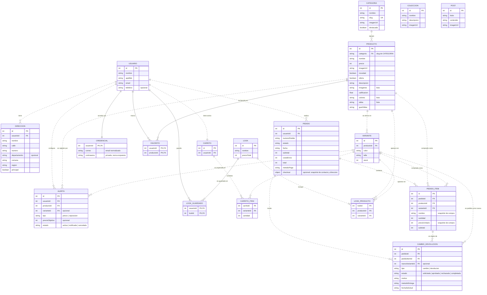

# Modelo Entidad–Relación — StyleNow

## Objetivo

Documentar el modelo de datos que el backend de StyleNow **ya usa hoy** en
Hito 2, como base conceptual para una futura fase de persistencia.

Fuentes revisadas (rama `feature/hito2-functional-complete`, que agrega auth,
favoritos, colecciones y comunidad sobre carrito, checkout y pedidos con
estado):

- DTOs de respuesta y de entrada (`src/dto`).
- Services (`src/services`).
- Contratos de repositorio (`src/repositorios/*.repository.ts`).
- Fixtures dummy y su test de coherencia (`src/data`).
- Tests unitarios y e2e de carrito, checkout, auth y favoritos.

El modelo no agrega entidades, campos ni relaciones que el código actual no
respalde. Todos los endpoints del backend funcionan con datos dummy en
memoria; ninguno responde 501.

Convenciones:

- Los IDs son numéricos, como en los contratos HTTP.
- Las FK son referencias conceptuales, no restricciones físicas ya
  implementadas. Las referencias implícitas (por ejemplo `usuarioId` fuera
  del DTO en los fixtures) se nombran como atributo `entidadId`.
- `?` indica un campo opcional del contrato: puede estar ausente. No define
  todavía su almacenamiento ni una política física de valores nulos.
- La tabla y el diagrama representan las relaciones actuales. `UK` en
  `Categoria.slug` identifica una clave candidata comprobada en los fixtures;
  no implica que exista una restricción de base de datos.
- Las líneas discontinuas del diagrama son relaciones no identificadoras:
  las referencias no forman parte de la PK propia de la entidad. Las líneas
  continuas son identificadoras: LookGuardado (usuario/look) y Favorito
  (usuario/producto) tienen clave compuesta, y Credencial se identifica por
  su usuario.
- CarritoItem no tiene PK declarada. En la implementación actual el par
  `(carritoId, varianteId)` identifica una línea; es una descripción del
  comportamiento, no una clave física implementada.
- La contraseña de Credencial es un dato privado: aparece en el modelo
  porque el backend la guarda, pero ningún DTO de salida, log ni mensaje de
  error la expone.
- Los tipos de atributo en Mermaid son conceptuales, no tipos de columna.
  `checkout` representa el objeto compuesto `SnapshotCheckout`, opcional
  para pedidos históricos y privado en las respuestas HTTP actuales.

## Entidades

| Entidad | PK | Campos relevantes | Descripción |
|---|---|---|---|
| Usuario | id | nombre, apellido, email, telefono? | Cliente de la tienda. Dueño de direcciones, pedidos, alertas, favoritos y carrito. Se crea con los fixtures o con `POST /auth/registro`; un usuario registrado nace con `apellido` vacío porque el registro no lo recibe. |
| Credencial | usuarioId (1:1 con Usuario) | usuarioId (FK), correo, contrasena (privada) | Credencial de acceso (`CredencialesRepository`), separada del perfil. `correo` es el email normalizado (sin espacios en los extremos y en minúsculas). La contraseña se guarda sin hashing en la fase dummy y nunca se expone. |
| Direccion | id | usuarioId (FK), nombre, calle, numero, departamento?, comuna, region, principal | Dirección de envío guardada en la cuenta del usuario. |
| Categoria | id | nombre, slug, imagenUrl, destacada | Agrupa productos del catálogo. `slug` es el valor que usa el filtro `?categoria=`. |
| Producto | id | categoria (slug → Categoria), nombre, precio, imagenUrl, novedad, oferta, descripcion, imagenes[], calificacion, colores[], tallas[], guiaTallas | Producto del catálogo. Es la única fuente del precio vigente. |
| Variante | id | productoId (FK), color, talla, stock | Combinación color + talla con su stock. Su id es único en todo el catálogo. |
| Pedido | id | usuarioId (FK), numeroPedido, estado, fecha, subtotal, costoEnvio, total, metodoPago, checkout? (snapshot: contacto {nombre, email, telefono}; dirección de despacho {calle, numero, departamento?, comuna, region}) | Compra de un usuario. Los pedidos creados por `POST /pedidos` guardan una copia privada del contacto y la dirección del checkout; los pedidos semilla no la tienen y la respuesta HTTP no la expone. |
| PedidoItem | id | pedidoId (FK), productoId (FK), varianteId (FK), nombre, cantidad, precioUnitario, subtotal | Línea de un pedido. Guarda nombre y precio al momento de la compra. |
| Carrito | id | usuarioId (FK) | Carrito activo de un usuario. `id` es su identidad propia: no se asume igual a `usuarioId`, aunque en las semillas coincidan. Es el `carritoId` que recibe `POST /pedidos`. |
| CarritoItem | No declarada (la implementación identifica la línea por `carritoId` + `varianteId`) | carritoId (FK), varianteId (FK), cantidad | Línea del carrito (`LineaCarritoPersistida`). Solo guarda variante y unidades; producto, nombre, imagen, talla, color y precio se leen del catálogo vigente al responder. |
| Look | id | nombre, precioTotal | Conjunto de prendas que se explora y se guarda. |
| LookProducto | No definida por el contrato | lookId (FK), productoId (FK), varianteId (FK) | Ocurrencia de una prenda en el arreglo `productos` de `LookResponseDto`. La misma tripleta puede repetirse; no se declara unicidad. |
| LookGuardado | (usuarioId, lookId) | usuarioId (FK), lookId (FK) | Registro de que un usuario guardó un look (`POST /usuarios/{usuarioId}/looks`). No es autoría. |
| Favorito | (usuarioId, productoId) | usuarioId (FK), productoId (FK) | Producto marcado como favorito por un usuario (`POST /usuarios/{usuarioId}/favoritos`). Se guarda el producto completo, sin variante. |
| Alerta | id | usuarioId (FK), productoId (FK), varianteId? (FK), tipo (`precio` \| `reposicion`), precioObjetivo?, estado (`activa` \| `notificada` \| `cancelada`) | Alerta de precio o aviso de reposición. |
| CambioDevolucion | id | pedidoId (FK), pedidoItemId (FK), nuevaVarianteId? (FK → Variante), tipo (`cambio` \| `devolucion`), estado (`solicitada` \| `aprobada` \| `rechazada` \| `completada`), motivo, metodoEntrega, fechaSolicitud | Solicitud de cambio o devolución sobre un item de un pedido. |
| Coleccion | id | nombre, descripcion, imagenUrl | Colección editorial de "Inspiración para ti" (`GET /colecciones`). Contenido de solo lectura, independiente de Look: no tiene productos ni precio. |
| Post | id | titulo, contenido, imagenUrl | Publicación de la sección Comunidad (`GET /posts`). Solo lectura; el contrato no define autor, likes ni comentarios. |

El modelo representa 18 estructuras: 15 entidades del dominio (Usuario,
Credencial, Direccion, Categoria, Producto, Variante, Carrito, CarritoItem,
Pedido, PedidoItem, Look, Alerta, CambioDevolucion, Coleccion y Post) y 3
asociaciones (LookProducto, LookGuardado y Favorito).

`LookProducto`, `LookGuardado` y `Favorito` no son entidades nuevas del
dominio. Son las asociaciones conceptuales necesarias para representar
relaciones que el código ya usa: el arreglo `productos` del look,
`LooksRepository.guardarParaUsuario(usuarioId, lookId)` y
`FavoritosRepository.agregar(usuarioId, productoId)`.

Coleccion y Post no se relacionan con otras entidades: sus contratos no
tienen referencias a usuarios, productos ni looks.

El contacto y la dirección de despacho del checkout no son entidades: son
valores copiados dentro de Pedido. No se crea una entidad Contacto ni se
reutiliza la entidad Direccion del perfil.

## Relaciones

| Entidad A | Cardinalidad | Entidad B | Explicación |
|---|---|---|---|
| Usuario | 1 : 0..N | Direccion | Cada dirección pertenece a un usuario (`DireccionesRepository.listarPorUsuario`, `buscarDeUsuario`). Una dirección ajena responde 404. |
| Usuario | 1 : 0..N | Pedido | Cada pedido pertenece a un usuario (`PedidosRepository.listarPorUsuario`, `buscarDeUsuario`). Un pedido ajeno responde 404. En un pedido nuevo, el dueño se obtiene de `carritoId` → Carrito → `usuarioId`, y el pedido guarda ese `usuarioId`. |
| Usuario | 1 : 1 (actual) | Carrito | Cada carrito pertenece a un usuario (`CarritosRepository.buscarPorUsuario`). Los usuarios semilla tienen un carrito en los fixtures y el registro crea el carrito vacío del usuario nuevo, con id propio; no existe restricción física. |
| Usuario | 1 : 1 | Credencial | Cada usuario tiene una credencial, semilla o creada en el registro (`CredencialesRepository`). El login la busca por correo normalizado. |
| Usuario | N : M | Producto | Vía Favorito: un usuario puede marcar varios productos y un producto puede ser favorito de varios usuarios. El mismo par no se repite (409). |
| Carrito | 1 : 0..N | CarritoItem | `carrito.items`. Un carrito puede estar vacío; el checkout exitoso lo vacía sin eliminarlo. |
| Variante | 1 : 0..N | CarritoItem | `linea.varianteId`. Cada línea pertenece a exactamente una variante, y hay a lo más una línea por variante dentro de un carrito. |
| Usuario | 1 : 0..N | Alerta | Cada alerta pertenece a un usuario (`AlertasRepository.listarPorUsuario`, `eliminar(usuarioId, alertaId)`). |
| Usuario | N : M | Look | Vía LookGuardado: un usuario puede guardar varios looks y un look puede ser guardado por varios usuarios. |
| Categoria | 1 : 0..N | Producto | `producto.categoria` contiene el slug de una categoría existente (lo verifica `dummy-coherencia.spec.ts`). |
| Producto | 1 : 0..N | Variante | `producto.variantes`. Todos los productos de los fixtures tienen variantes, pero ningún DTO exige un mínimo. |
| Pedido | 1 : 0..N | PedidoItem | `pedido.items`. Cada item tiene id propio (`pedidoItemId`). Ningún DTO exige un mínimo de items. |
| Producto | 1 : 0..N | PedidoItem | `item.productoId`. |
| Variante | 1 : 0..N | PedidoItem | `item.varianteId`. La variante pertenece al producto del item. |
| Look | 1 : 1..N | LookProducto | `look.productos`. `CrearLookDto` exige `@ArrayMinSize(1)` en POST /looks; no exige elementos distintos. |
| Producto | 1 : 0..N | LookProducto | `productoId` de cada ocurrencia en el look. |
| Variante | 1 : 0..N | LookProducto | `varianteId` de cada ocurrencia. Debe pertenecer al producto indicado. |
| Producto | 1 : 0..N | Alerta | Toda alerta apunta a un producto. |
| Variante | 0..1 : 0..N | Alerta | Referencia opcional, solo en reposición. Un aviso puede omitirla y vigilar cualquier variante del producto. |
| Pedido | 1 : 0..N | CambioDevolucion | La solicitud se crea en `/usuarios/{id}/pedidos/{pedidoId}/cambios-devoluciones`. |
| PedidoItem | 1 : 0..N | CambioDevolucion | `pedidoItemId` debe ser un item del mismo pedido. |
| Variante | 0..1 : 0..N | CambioDevolucion | `nuevaVarianteId`: obligatoria en un cambio y prohibida en una devolución, según el Service. |

En cada fila A:B, el primer rango indica cuántos A referencia cada B y el
segundo cuántos B puede tener cada A. Usuario–Look se descompone en dos
relaciones 1:0..N hacia LookGuardado; ambas colecciones pueden estar vacías.
Usuario–Producto (favoritos) se descompone igual, en dos relaciones 1:0..N
hacia Favorito.
Usuario–Carrito es 1:1 desde ambos extremos en el estado actual: cada carrito
tiene un dueño y cada usuario (semilla o registrado) tiene exactamente un
carrito activo. Usuario–Credencial también es 1:1.

Relaciones que **no** existen como referencia almacenada:

- **CarritoItem → Producto:** la línea solo guarda `varianteId`. El producto
  se alcanza por CarritoItem → Variante → Producto; `productoId` en
  `ItemCarritoResponseDto` es un dato derivado de la respuesta.
- **Pedido → Carrito:** el carrito es el origen del checkout, pero el pedido
  no guarda `carritoId`.
- **Pedido → Direccion:** la dirección de despacho es una copia dentro del
  pedido, no una referencia a la dirección del perfil.

El mínimo de LookProducto describe la creación HTTP validada, no una
restricción adicional del contrato de repositorio del dominio.

## Diagrama ER

## Reglas de integridad

### A. Reglas actualmente validadas

**En las rutas HTTP y Services:**

- Las direcciones, los pedidos y las alertas pertenecen a un usuario existente. Pedir el recurso de otro usuario responde 404 (Services + `dummy-coherencia.spec.ts`).
- Una variante pertenece a su producto: looks, alertas y cambios validan el par `(productoId, varianteId)` con `ProductosService.obtenerVarianteDeProducto`.
- Un item pertenece a su pedido: un cambio o devolución exige que `pedidoItemId` sea un item del pedido de la ruta (`PedidosService.obtenerItemDePedido`).
- Un cambio exige `nuevaVarianteId`, distinta de la variante comprada y del mismo producto. Una devolución no admite `nuevaVarianteId`.
- Toda solicitud de cambio o devolución nace en estado `solicitada`.
- Toda alerta nueva nace en estado `activa`. `precioObjetivo` es opcional en alertas de precio; `varianteId` es opcional en avisos de reposición. Los DTO de entrada permiten omitirlos o enviarlos como null, y el Service los transforma en campos ausentes.
- Crear un look por HTTP exige al menos una ocurrencia (`CrearLookDto`). Se permite repetir el mismo par producto/variante; cada ocurrencia aporta su precio a `precioTotal`.
- Guardar el mismo look para el mismo usuario es idempotente: `DummyLooksRepository` usa un Set del par usuario/look. Por eso la clave compuesta de LookGuardado conserva la semántica actual.
- `CrearCambioDevolucionDto` valida `tipo` contra `TIPOS_SOLICITUD`. Las rutas de alertas seleccionan el tipo sin recibirlo como dato libre.

**En auth y favoritos:**

- El registro rechaza un correo ya usado, comparándolo normalizado (409). Los registros se procesan en orden, así que dos altas simultáneas no crean dos cuentas con el mismo correo.
- El registro crea el usuario, su credencial y su carrito vacío. El usuario nuevo puede usar el resto de la API.
- El login exige que correo y contraseña coincidan con una credencial; si no, responde 401 con el mismo mensaje en ambos casos.
- El cambio de contraseña exige la contraseña actual correcta y una nueva distinta; desde ese momento solo la nueva sirve para el login.
- Ninguna respuesta, log HTTP ni mensaje de error incluye la contraseña.
- Un favorito exige usuario y producto existentes, y el mismo producto no se guarda dos veces para el mismo usuario (409).

**En carrito y checkout:**

- Una línea de carrito tiene cantidad entera positiva (`AgregarItemCarritoDto` y `ActualizarCantidadDto`).
- La variante debe existir y tener stock; la cantidad de la línea no puede superar el stock al agregar (cantidad existente + nueva) ni al actualizar (`CarritoService.comprobarStock`).
- La misma variante se representa como una sola línea por carrito: agregarla otra vez suma unidades a la línea existente.
- Actualizar o eliminar exige que la línea exista en el carrito del usuario.
- El checkout revalida cada variante, su pertenencia al producto y su stock contra el catálogo vigente.
- Un carrito vacío no genera pedido.
- El pedido creado pertenece al dueño del carrito, y sus items copian nombre y precio del producto en ese momento.
- El checkout exitoso vacía las líneas del carrito y conserva el carrito. Si el checkout falla, no queda pedido creado y el carrito conserva sus líneas.
- El stock del catálogo no se descuenta al crear el pedido.
- Comportamiento actual del checkout dummy: el pedido nuevo nace con `estado = "confirmado"`, `costoEnvio = 0` (el checkout no recibe modalidad de despacho), `total = subtotal + costoEnvio`, y `numeroPedido` se genera como `SN-<año de la fecha>-<id>`. Como los ids se asignan sin repetirse dentro de la instancia, los números generados no se repiten. Estos valores describen la implementación actual, no reglas universales del modelo.

**Comprobadas sobre los fixtures en `dummy-coherencia.spec.ts`:**

- El slug de una categoría es único y tiene forma de slug. Es una clave candidata/alternativa a su PK numérica `id` dentro de este catálogo.
- Todo producto pertenece a una categoría existente mediante su slug.
- Los ids de usuario, producto, categoría, pedido e item de pedido no se repiten.
- Cada usuario semilla tiene una credencial cuyo correo es su email normalizado, y un carrito.
- El id de variante es único en **todo** el catálogo. `ProductosRepository.buscarVariante(varianteId)` presupone esa identidad global; por sí solo no valida unicidad.
- Las referencias entre usuarios, catálogo, pedidos, looks, alertas y solicitudes son coherentes.
- El `nombre` y el `precioUnitario` de cada `PedidoItem` coinciden con el catálogo de la semilla; representan un snapshot, no una regla de sincronización histórica.

Estas comprobaciones de fixtures no son restricciones físicas ni validadores
generales de cualquier escritura directa en un repositorio.

### B. Declaraciones del contrato sin validación general de persistencia

- `RegistrarUsuarioDto.correoElectronico` se describe como identificador único de la cuenta y se guarda como `email` del usuario y `correo` de la credencial. El registro rechaza correos repetidos, pero es una regla del Service sobre el estado en memoria, no una restricción física: el MER no marca email como UK.
- `UsuarioResponseDto` (registro y login) expone `id`, `nombre` y `correoElectronico`; `AuthResponseDto` no incluye token porque no hay JWT ni sesiones de servidor. El logout solo confirma el cierre.
- `tipo` y `estado` de Alerta y CambioDevolucion tienen tipos enumerados en `alerta.tipos.ts` y `cambio-devolucion.tipos.ts`. Los DTO de respuesta describen esos valores; los estados no son una máquina de transiciones ni una restricción física implementada.
- `Pedido.estado` es texto libre; el contrato no define un enum. Que los pedidos nuevos nazcan `confirmado` no lo convierte en enumeración.
- `CarritoResponseDto.id` expone la identidad del carrito para usarla como `carritoId` en `POST /pedidos`. `CrearPedidoDto` no recibe `usuarioId`: el dueño sale del carrito.
- `PedidoDetalleResponseDto` no incluye el snapshot de checkout; su existencia es interna del repositorio.

### C. Decisiones abiertas para una futura persistencia

- Convertir la unicidad del correo en una restricción física y decidir cómo guardar la contraseña (hashing) al pasar a una persistencia real.
- `numeroPedido` es un número visible, pero su DTO no declara unicidad. Hoy los números generados no se repiten porque derivan de ids únicos dentro de la instancia; eso no establece una restricción física. Una clave candidata futura debe acordarse antes de implementarla. No se marca como UK.
- Que cada usuario tenga a lo más un carrito activo describe la implementación actual; una restricción física futura deberá acordarse.
- La identidad persistente de CarritoItem: hoy `(carritoId, varianteId)` identifica la línea.
- Cómo persistir el snapshot de checkout del pedido (atributos propios o estructura embebida), conservando que es una copia.
- No se exige una sola dirección principal por usuario.
- La identidad persistente de cada ocurrencia de LookProducto queda abierta, preservando los duplicados permitidos. No se propone unicidad de la tripleta.

## Decisiones de modelado

**Variante como entidad independiente.** Tiene id propio, único en todo el
catálogo, y es referenciada directamente por PedidoItem, LookProducto,
Alerta y CambioDevolucion. Además lleva su propio `stock`. Por eso no puede
ser un atributo multivaluado del producto. Los arreglos `colores` y
`tallas` del producto se mantienen como atributos de presentación de la
ficha, tal como hoy los expone `ProductoDetalleResponseDto`.

**PedidoItem conserva nombre y precio de compra.** `nombre` y
`precioUnitario` son la foto del catálogo al momento de la compra (lo
documentan los fixtures). Si después cambian el precio o el nombre del
producto, el pedido histórico no se altera. Las FK a Producto y Variante se
mantienen para trazabilidad y para validar cambios y devoluciones.

**Contacto y dirección de checkout como snapshot, sin FK.** `POST /pedidos`
recibe `contacto` (nombre, email, telefono) y `direccion` (calle, numero,
departamento?, comuna, region) como **valores** dentro de `CrearPedidoDto`,
no como un `direccionId`. Los pedidos creados por el checkout guardan una
copia privada de ambos. Es una foto histórica: no cambia si el usuario
modifica después su dirección de perfil, y por eso no existe una relación
Pedido → Direccion ni una entidad Contacto. Los pedidos semilla no tienen
snapshot y la respuesta HTTP no lo expone.

**Carrito con identidad propia.** El carrito tiene `id` propio y se
relaciona con su dueño por `usuarioId`; el código no asume que ambos
coincidan. `POST /pedidos` recibe `carritoId`, obtiene el carrito y toma su
`usuarioId` como dueño del pedido. El carrito es el origen del checkout,
pero el pedido no guarda `carritoId`: por eso no hay relación Pedido →
Carrito.

**CarritoItem sin datos de catálogo.** La línea solo guarda `varianteId` y
`cantidad`. Producto, nombre, imagen, talla, color y precio se resuelven al
responder desde Variante y Producto, así el carrito siempre muestra precios
vigentes y no duplica datos. No hay referencia directa a Producto: se llega
por CarritoItem → Variante → Producto. El precio solo se congela al crear el
pedido, en PedidoItem.

**Concurrencia fuera del modelo.** La implementación dummy coordina en
memoria las operaciones concurrentes sobre un mismo carrito y el checkout
(colas por carrito y compensación si el vaciado falla). Es un detalle de la
implementación; no agrega entidades ni relaciones al modelo conceptual.

**Credencial separada del perfil.** La contraseña vive en `Credencial`, no
en Usuario, para que ningún DTO de usuario pueda incluirla por accidente.
Es parte del modelo porque el backend la guarda y la usa (login y cambio de
contraseña), pero se marca como dato privado. La relación es 1:1 y la
credencial se identifica por el usuario.

**Favorito como asociación Usuario–Producto.** El contrato guarda el
producto completo, sin variante, una vez por usuario. Se modela como
asociación con clave compuesta usuario/producto porque el repetido se
rechaza con 409.

**Coleccion y Post como entidades independientes.** Sus DTO solo tienen
datos editoriales (id, título o nombre, texto e imagen) y ningún id de otra
entidad. Coleccion no se deriva de Look: Look agrupa productos y tiene
precio; Coleccion no. Post no tiene autor porque el contrato no lo define.

**Look no tiene autor persistente.** `LookResponseDto` no tiene `usuarioId`
y `POST /looks` no recibe usuario. La única relación Usuario–Look que el
código respalda es "guardar un look" (`guardarParaUsuario`), modelada como
la asociación N:M `LOOK_GUARDADO`, que no representa autoría.

**`nuevaVarianteId` opcional en CambioDevolucion.** Una sola entidad
representa los dos tipos de solicitud, discriminados por `tipo`.
`nuevaVarianteId` es una referencia opcional a Variante: obligatoria cuando
`tipo = cambio` y ausente cuando `tipo = devolucion` (null de entrada se
normaliza a ausencia). La regla vive en
`CambiosDevolucionesService`, no en el esquema.

**Alerta apunta opcionalmente a una variante.** Una alerta siempre vigila
un producto. Un aviso de reposición puede especificar una variante (color
y talla) u omitirla para cualquier variante del producto; `varianteId` es
opcional. `precioObjetivo` también es opcional y solo corresponde a alertas
de precio. Ninguno de los dos campos es obligatorio para crear su tipo de alerta.

**Producto → Categoria por slug.** El contrato expone `producto.categoria`
como slug, y así filtra `GET /productos?categoria=`. En el modelo se
representa como FK lógica hacia `categoria.slug`. La Fase 2 podrá decidir
cómo persistir la referencia sin cambiar el contrato. `Categoria.id` sigue
siendo la PK numérica; `slug` es una clave candidata/alternativa única en los
fixtures, no una segunda PK ni una garantía física existente.

**IDs numéricos.** Las entidades con id propio usan enteros, no UUID.
LookGuardado usa el par usuario/look como clave compuesta porque el guardado
es idempotente. LookProducto representa ocurrencias del arreglo, sin PK
declarada en esta fase conceptual: ausencia de id en el DTO no justifica
deducir una clave compuesta. No se añade un campo posición, orden ni id que
el contrato no expone. El diagrama permite varias ocurrencias con los mismos
lookId, productoId y varianteId.

## Fuera de alcance Hito 2

Este documento es solo de diseño conceptual. No incluye esquema físico,
librerías de persistencia, scripts de creación o carga, configuración ni
infraestructura de base de datos. No cambia el código ni los contratos HTTP.

Hito 2 incluye el modelo ER conceptual y el backend dummy con estado en
memoria. No incluye SQL, MySQL, TypeORM, migrations, entidades ORM ni una
implementación de base de datos. Tampoco incluye JWT ni sesiones de servidor.

### Ambigüedades abiertas para la Fase 2

- **Atributos multivaluados de Producto** (`imagenes`, `colores`, `tallas`):
  hoy son arreglos del DTO. Su representación persistente queda abierta.
  No se modelan como entidades porque nada los referencia por id.
- **Identidad de LookProducto:** el contrato permite repetir la misma
  prenda dentro de un look. El modelo no impone una PK compuesta ni
  unicidad de la tripleta. La representación persistente de cada ocurrencia
  se decidirá conservando esa semántica y sin añadir campos HTTP.
- **Una sola dirección principal por usuario:** `principal` existe, pero
  el Service no garantiza que solo una dirección lo sea. No se declara
  como regla.
- **`estado` de Pedido** es texto libre en el DTO (ejemplo `confirmado`).
  No se enumeran valores que el código no define.
- **Fechas** (`pedido.fecha`, `fechaSolicitud`) viajan como texto ISO 8601.
  El tipo de columna se decidirá en la Fase 2.
- **Unicidad física** de `email` y `numeroPedido`: ver la sección C de
  reglas de integridad.
- **Persistencia real:** fuera del alcance de Hito 2.
